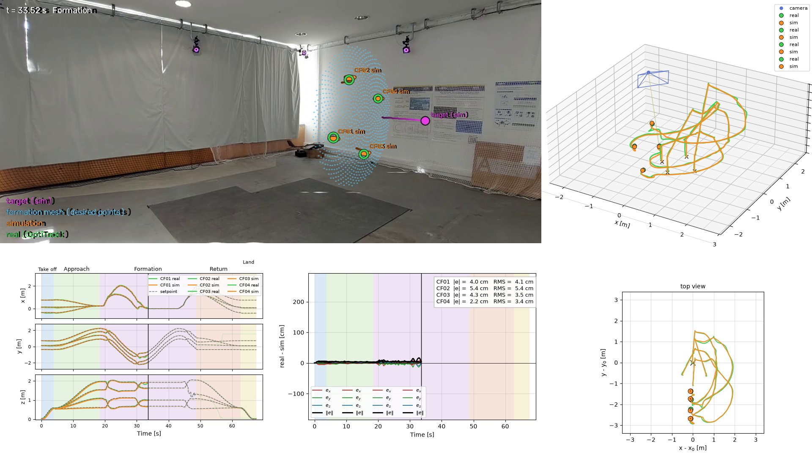
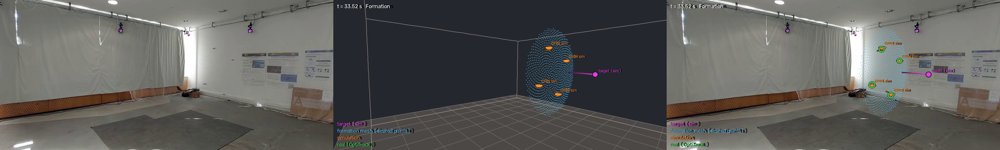
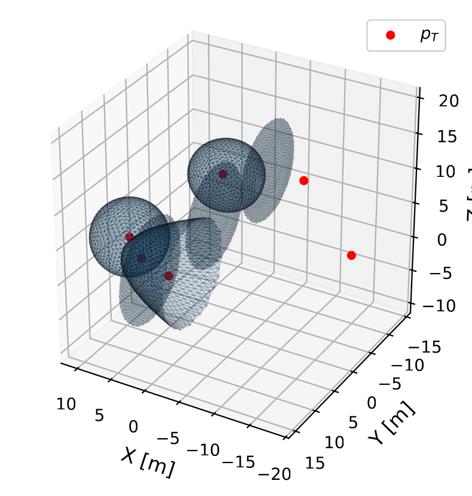
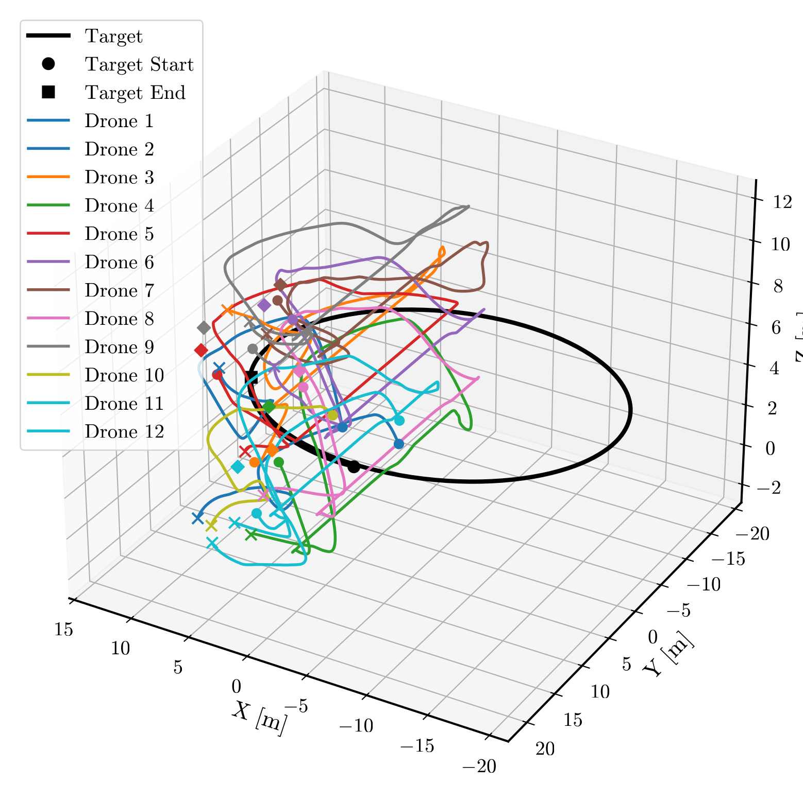
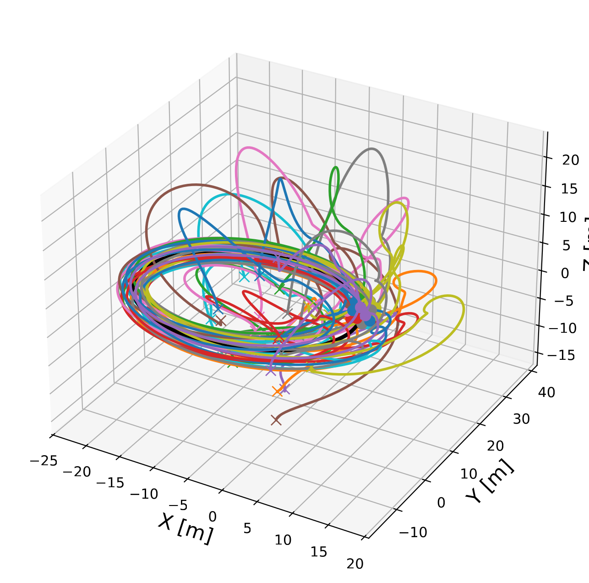
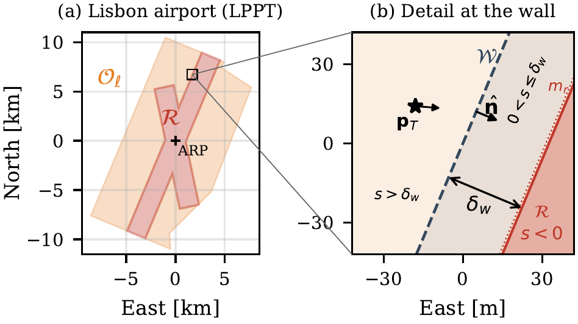

# Cooperative Encirclement of Non-Cooperative Drones

*Decentralized, Collision-Aware Formation Control on Spherical and Generalized Surfaces*

MSc thesis in Electrical and Computer Engineering, NOVA FCT, by Filipe Cavalheiro (adviser: Prof. Bruno J. Guerreiro). Submitted 2026-09-30.

A swarm of chaser drones surrounds a moving, non-cooperative target drone. The chasers are spread over a surface around the target: a sphere (Fibonacci lattice) or a general surface (Voronoi / CVT mesh). Each chaser reaches its point through decentralized control with collision avoidance (APF, CBF, distributed MPC). This repository holds the MATLAB prototypes, the Python simulations, the Crazyflie + OptiTrack flight code, the thesis report and the defence presentation.

## What the repository does

**Real flight vs simulation, on the same video.** Four Crazyflies fly the Voronoi formation with the distributed MPC around a virtual target, filmed with a phone tracked by OptiTrack. The overlay tool draws the simulated drones (orange), the real OptiTrack positions (green rings), the formation mesh and the virtual target over the video, and the dashboard compares real and simulated trajectories over the whole flight (a few cm RMS apart):





**Simulations.** A swarm keeps a formation around a moving target that it can only estimate (distributed estimation), avoids collisions, and changes the formation shape on the fly. With the restricted-airspace layer, it forms a wall in front of the Lisbon airport's prohibited zone.

| Formation that changes shape (sphere, cone, disc) along the target's path | 12 drones with the distributed MPC around a moving target |
|---|---|
|  |  |
| **31 drones on the Fibonacci sphere, following a moving target** | **Restricted airspace: the Lisbon airport zones and the drones' wall** |
|  |  |

## Repository layout

This README is an overview. Each category is explained in more detail in the README inside its folder, linked in the **Details** column ("—": no README there yet).

| Folder | Content | Details |
|---|---|---|
| `Thesis_report/` | LaTeX source of the thesis (NOVAthesis template). The submitted PDF is `Thesis_70119_Filipe_Cavalheiro.pdf` | [`Thesis_report/README.md`](Thesis_report/README.md) |
| `Presentation/` | Defence slides (Manim + manim-slides), with `SPEAKER_NOTES.md` | [`Presentation/README.md`](Presentation/README.md) |
| `Matlab/` | Early prototypes: Fibonacci-sphere controllers (v1–v9: Lyapunov, APF, consensus, CBF) and their Voronoi continuation (`voronoin/`, v10–v14), CBF/HOCBF studies, consensus, point-spreading method comparisons (Fibonacci, lat/lon, Poisson disk, Thomson, Voronoi), geometric mesh transforms, Mellinger + minimum-snap, CAPTURE drone models | [`Matlab/README.md`](Matlab/README.md) |
| `Python/flight_sims/` | Python simulations (full 3D quadrotor dynamics, Mellinger control) | per simulation, see the table below |
| `Python/demos_and_helpers/` | Small demos (Bernstein polynomials, weighted CVT, QP with constraints, weighted mesh) and the `video_overlay` tools (phone calibration, flight-video overlay and dashboard) | [`video_overlay`](Python/demos_and_helpers/video_overlay/README.md), [`CVT_weighted_verticies`](Python/demos_and_helpers/CVT_weighted_verticies/README.md), [`weighted_mesh_demo`](Python/demos_and_helpers/weighted_mesh_demo/README.md) |
| `Crazy_Flie/` | Real flights with Crazyflie drones: `Optitrack/` (current) and `Lighthouse/` (older, Lighthouse positioning) | [`Crazy_Flie/README.md`](Crazy_Flie/README.md), [`Optitrack/README.md`](Crazy_Flie/Optitrack/README.md) |
| `docs/images/` | Images used in this README | — |

### Python simulations (`Python/flight_sims/`)

| Folder | What it simulates | Details |
|---|---|---|
| `swarm_geometric_Fibonacci_sim_target` | Hierarchical control on the two-sphere: Fibonacci points, Hungarian assignment, APF, adaptive radius (`main.py`); `main.py --IRL_log` replays the matching real flight, for sim-vs-real comparison | [README](Python/flight_sims/swarm_geometric_Fibonacci_sim_target/README.md) |
| `swarm_MPC_voronoi` | The thesis simulation (V17): Voronoi formation on a morphing mesh, distributed estimation, Delaunay network, distributed Bernstein MPC solved with ADMM, restricted airspace. Trajectories 1-6 (`--traj K`) in two scenes (`--scene`): `lisbon`, the Lisbon airport (1-4 across the drones' wall into the grey band, 5-6 the intrusions into the prohibited area), and `arena`, the 6 x 6 x 3 m Crazyflie arena (1-4 across a wall at x = 0, 5-6 scaled slices of the Lisbon flights). `--arena` / `--IRL_log`: the `swarm_MPC_voronoi` Crazyflie flight, which uses this simulation's MPC (formation only / the whole flight from its log) | [README](Python/flight_sims/swarm_MPC_voronoi/README.md) |
| `8traj`, `swarm_take_off_hover_land` | Simulations of the matching real flights, for sim-vs-real comparison | [8traj](Python/flight_sims/8traj/README.md), [swarm_take_off_hover_land](Python/flight_sims/swarm_take_off_hover_land/README.md) |

## How to run: simulation, real flight, and the overlay that joins them

### Setup: one Python environment for everything

A single environment at the repository root (`.venv`, from `requirements.txt`) runs the simulations, the Crazyflie flights and the video overlay. Only `Presentation/` has its own, for Manim.

```bash
python3 -m venv .venv
.venv/bin/python -m pip install -r requirements.txt     # once
source .venv/bin/activate                                # in every new terminal
```

With the environment active, `python` works from any folder. The commands below start from the repository root.

### 1. A Python simulation

Thesis simulation (Lisbon airport, Voronoi formation + distributed MPC). The settings are in `Structs_sim.py`:

```bash
cd Python/flight_sims/swarm_MPC_voronoi/Python && python main.py
```

Other trajectories and the Crazyflie arena: `python main.py --traj K --scene lisbon|arena`. The other simulations in `Python/flight_sims/` (Fibonacci sphere, 8traj, take off / hover / land) run the same way, with `python main.py` in their folder. See each folder's README.

### 2. A Crazyflie flight (filmed with the phone)

The overlay needs a flight that also logs the phone's pose. The flights that do this are `swarm_take_off_hover_land`, `8traj.py`, `swarm_geometric_Fibonacci_sim_target` and `swarm_MPC_voronoi`, and all expect the phone to be rigid body **0** in Motive (`CAMERA_RIGID_BODY_ID = 0`).

1. Switch on the drones and Motive. Place every drone pointing along +X of the tracking frame.
2. Start recording on the phone. Then **pan and tilt it briskly a few times**: this is what syncs the video with the flight log.
3. Fly (for example, from the repository root):
   ```bash
   cd Crazy_Flie/Optitrack/swarm_take_off_hover_land && python main.py   # swarm: take off, hover, land
   cd Crazy_Flie/Optitrack && python 8traj.py                              # one drone: figure 8
   ```
   **1st Ctrl+C**: the drones return home and land. **2nd Ctrl+C**: motors off, the drones fall.
4. Stop the phone recording. Copy the video into the new run folder `Results/<flight code>_trajectory_<date>/` as **`video.mp4`**.
   The folder already holds `trajectory_<date>.csv` (flight log), `_camera.csv` (phone poses) and `_camera.json` (time origin).

### 3. Simulate that flight

This replays the real flight's setpoints on the simulated Crazyflie, starting from the logged state. It writes `trajectory_<date>_sim.csv` and a `comparison/` folder next to the log:

```bash
python Python/flight_sims/swarm_take_off_hover_land/main.py --IRL_log Results/swarm_take_off_hover_land_trajectory_<date>/trajectory_<date>.csv --no-show
python Python/flight_sims/8traj/main.py --IRL_log Results/8traj_trajectory_<date>/trajectory_<date>.csv --no-show
python Python/flight_sims/swarm_geometric_Fibonacci_sim_target/main.py --IRL_log Results/swarm_geometric_Fibonacci_sim_target_trajectory_<date>/trajectory_<date>.csv --no-show
```

With `--IRL_log` and no path, the newest run of that flight is used. The Fibonacci flight does not log the phone pose, so it stops here (no overlay). Without `--IRL_log`, `main.py` runs the simulation alone: only the Main Controller, every value from the `Structs.py` of that folder, nothing from a real run.

### 4. Overlay: the real video with the simulated drones

```bash
python Python/demos_and_helpers/video_overlay/flight_overlay.py Results/swarm_take_off_hover_land_trajectory_<date>/trajectory_<date>.csv
```

Steps 3 and 4 run from the repository root: no need to change folder between them.

The results go to `Results/<run>/overlay/`:
- `overlay.mp4`: the real video, with the simulated drones in orange and the real OptiTrack positions as green rings
- `sim_camera.mp4`, `side_by_side.mp4`, `dashboard.mp4`
- `stills/`, `overlay_metrics.csv`, `sync.json`

Useful options:

| Option | Effect |
|---|---|
| `--no-dashboard` | skip the dashboard (the slow part, ~0.4 s per frame) |
| `--no-video` | only sync, stills and metrics (quick check) |
| `--offset S` | set the sync by hand: video time = flight time + S |
| `--flip on\|off` | force the phone orientation (default: automatic) |
| `--grid` | draw the floor grid: it must stick to the floor (calibration check) |

Check `sync.json`: `correlation` should be ≥ 0.5 and well above `next_best_correlation`. If it isn't, film the pan/tilt gestures more clearly or use `--offset`.

The overlay needs the phone camera calibration in `Results/phone_calib/` (used by default; it is not in the repository). Make it once, and again whenever the phone's rigid body or markers change in Motive: see ["Phone camera correction in Motive"](Python/demos_and_helpers/video_overlay/README.md#phone-camera-correction-in-motive-one-time-alternative-to-the-hand-eye-step) in the video overlay README.

## Real flights (Crazyflie + OptiTrack)

Everything is in `Crazy_Flie/Optitrack/`. The drones use the onboard Kalman filter and get their external position from OptiTrack (Motive, NatNet unicast).

### Setup

The Python environment is the root `.venv` (see [Setup](#setup-one-python-environment-for-everything)): `source .venv/bin/activate`.

Set the network and drones in each script's configuration (`Structs.py` in the swarm folders): `MOTIVE_IP`, `LOCAL_IP`, the radio URIs (`CANDIDATE_URIS`, ending in 01, 02, ...) and the Motive rigid-body IDs (the same number as the URI). Place every drone pointing along +X of the tracking frame (the Kalman filter assumes yaw ≈ 0 at reset).

### Flight scripts

| Script | Flight | Details |
|---|---|---|
| `takeoff_hover_land.py` | One drone: take off, hover, land | [Optitrack README](Crazy_Flie/Optitrack/README.md#standalone-scripts) |
| `8traj.py`, `box.py` | One drone: figure 8 / back and forth inside a box | [Optitrack README](Crazy_Flie/Optitrack/README.md#standalone-scripts) |
| `swarm_8traj.py`, `swarm_fibonacci.py` | Swarm: figure 8 on separate layers / Fibonacci sphere moving on a circle | [Optitrack README](Crazy_Flie/Optitrack/README.md#standalone-scripts) |
| `swarm_take_off_hover_land/main.py` | Swarm check to run first with new drones, batteries or gains | [README](Crazy_Flie/Optitrack/swarm_take_off_hover_land/README.md) |
| `swarm_geometric_Fibonacci_sim_target/main.py` | Geometric Fibonacci encirclement of a virtual target | [README](Crazy_Flie/Optitrack/swarm_geometric_Fibonacci_sim_target/README.md) |
| `swarm_voronoi_sim_target/main.py` | Voronoi formation around a virtual target | [README](Crazy_Flie/Optitrack/swarm_voronoi_sim_target/README.md) |
| `swarm_MPC_voronoi/main.py` | Voronoi formation with the distributed MPC. `--target sim` (virtual target, default) or `--target real` (a Crazyflie flies the target path) | [README](Crazy_Flie/Optitrack/swarm_MPC_voronoi/README.md) |

The swarm scripts find the drones that are switched on, check tracking and battery, then fly: take off → mission → return above the take-off points → land → disarm. A flight aborts (and returns and lands) if tracking is lost or a drone leaves the arena or goes above the height limit.

### Logs and analysis

Every flight writes `Results/<flight code>_trajectory_<date>_<time>/` (created by the flight scripts; flight logs are not in the repository) (OptiTrack and estimator position, velocity, attitude, rates, flight phase; plus the phone pose when `CAMERA_RIGID_BODY_ID` is set).

```bash
cd Crazy_Flie/Optitrack
python plot_data.py                               # plots of the newest flight log
python plot_data.py path/to/log.csv --animate
python flight_sim.py swarm_MPC_voronoi --target sim   # simulate the flight from its log and compare
python flight_sim.py swarm_voronoi_sim_target --dry-run --drones 3   # no log: simulate before flying
```

## Thesis and presentation

```bash
cd Thesis_report && make            # LuaLaTeX build of template.tex (make pdf / make xe for other engines)
cd Presentation  && manim-slides render -ql slides.py $(cat scenes.txt)   # see Presentation/README.md
```

## License

- **Code** (MATLAB, Python, Crazyflie, presentation scripts): GNU GPL v3, see [`LICENSE`](LICENSE).
- **Thesis document** (the text and figures in `Thesis_report/`, and the compiled PDF): GNU Free Documentation License 1.3 or later, with no Invariant Sections, no Front-Cover Texts and no Back-Cover Texts, see [`LICENSE-GFDL`](LICENSE-GFDL). The full license text is also printed as the last annex of the thesis.
- **NOVAthesis template** files (`Thesis_report/novathesisFiles/`, class and build files): LaTeX Project Public License, see [`Thesis_report/LICENSE`](Thesis_report/LICENSE).
